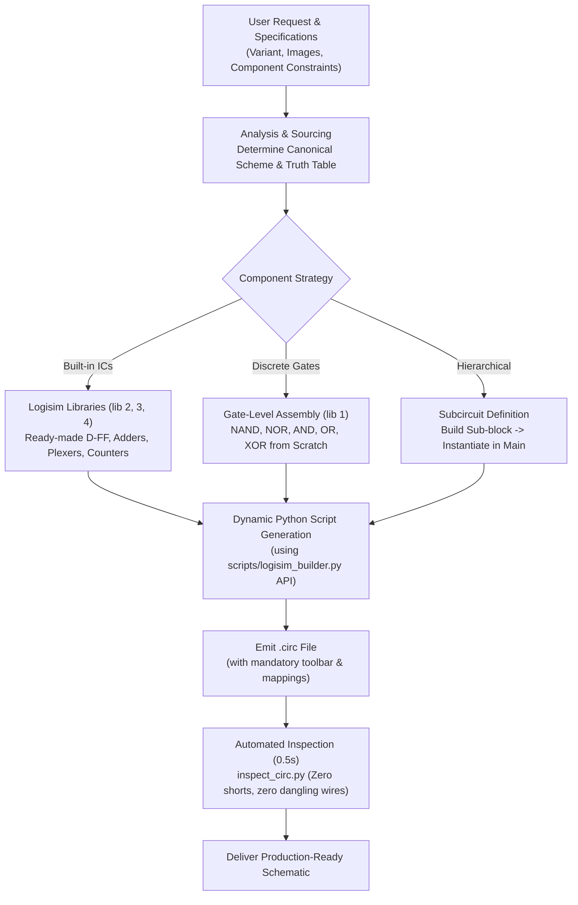

# Logisim Circuit Architect Skill

A complete engineering specification, reference manual, and universal synthesis workflow for generating 100% compliant, pixel-perfect `.circ` circuit files that open natively in **Logisim 2.7.1** and **Logisim-evolution** with zero graphical glitches, full GUI toolbar interactivity, zero disconnects, and immediate simulation readiness.

---

## 1. Universal Synthesis Architecture & Agent Workflow

The agent operates as an autonomous, senior hardware and logic design engineer. The skill is completely flexible and universal: it empowers the agent to build **any digital circuit requested by the user**, whether simple or complex, whether built from high-level built-in library ICs, assembled from discrete logic gates, or organized as a hierarchical multi-sheet project.

### 1.1 The Complete Synthesis Pipeline



### 1.2 Core Execution Guidelines
1. **Dynamic Script Generation:**
   - The agent is **not restricted** to hardcoded template functions. The agent can and should write custom Python generator scripts tailored to the user's exact requirements using the clean object-oriented builder API (`Project`, `Circuit`, `Pin`, `Component`, `Subcircuit`, `wire`, `connect`, `add_vbus`, `add_hbus`).
   - The pre-built functions in `scripts/logisim_builder.py` (`build_matrix_encoder`, `build_decoder_2to4`, `build_multiplexer_4to1`, `build_full_adder`, `build_async_counter_4bit`, etc.) serve as high-quality reference implementations and rapid shortcuts, but the agent dynamically synthesizes any custom schematic on demand.
2. **Sourcing Canonical Reference Schematics:**
   - When a requested circuit is non-trivial, unfamiliar, or models a specific real-world chip/assignment (e.g. 74LS138, 74LS151, specific textbook counter or divider):
     - Check authoritative textbooks, datasheets, or perform a targeted web search for the standard circuit diagram and truth table.
     - Verify that the schematic is widely recognized and canonical in academic/engineering practice.
     - Faithfully implement that scheme in Logisim coordinates.
3. **Pragmatic Testing Policy (No Blind Exploration vs Verifying Complex Logic):**
   - **Do NOT waste turns writing throwaway discovery tests** just to figure out Logisim XML syntax or basic pin coordinates. All pin geometries, offsets, grid snapping, and routing invariants are fully documented in this skill.
   - For standard circuits (decoders, multiplexers, encoders, adders, basic counters), immediately generate the `.circ` file.
   - For **genuinely complex, novel, or intricate circuits** (e.g. multi-stage state machines, complex hazard-free feedback latches, custom ALUs), functional testing and truth-table verification using `scripts/inspect_circ.py` or simulation is welcomed and encouraged.
4. **Strict Fidelity to User Constraints:**
   - If the user specifies: *"use built-in D-flip-flop"* $\implies$ use `lib="4" name="D Flip-Flop"`.
   - If the user specifies: *"assemble D-flip-flop from discrete logic gates"* $\implies$ build it from discrete NAND/NOR gates.
   - If the user provides a reference screenshot or wiring diagram $\implies$ recreate that exact layout and pin arrangement.

---

## 2. Mandatory GUI Toolbar & Mouse Mappings

### 2.1 The Missing Toolbar Bug
When Logisim loads a `.circ` file that lacks `<toolbar>` and `<mappings>` elements inside the root `<project>`, it initializes in a **stripped/headless view mode**:
- The top toolbar is completely absent.
- The **Poke Tool** (Hand tool `lib="6" name="Poke Tool"`), **Edit Tool** (Selection arrow), and **Text Tool** disappear.
- The user is unable to click input pins, toggle signals, or interact with the simulation.

### 2.2 Mandatory XML Block
Every generated `.circ` file **must** include the following blocks directly after `<options>` in the `<project>` tag:

```xml
  <mappings>
    <tool lib="6" map="Button2" name="Menu Tool"/>
    <tool lib="6" map="Button3" name="Menu Tool"/>
    <tool lib="6" map="Ctrl Button1" name="Menu Tool"/>
  </mappings>
  <toolbar>
    <tool lib="6" name="Poke Tool"/>
    <tool lib="6" name="Edit Tool"/>
    <tool lib="6" name="Text Tool">
      <a name="text" val=""/>
      <a name="font" val="SansSerif plain 12"/>
      <a name="halign" val="center"/>
      <a name="valign" val="base"/>
    </tool>
    <sep/>
    <tool lib="0" name="Pin">
      <a name="tristate" val="false"/>
    </tool>
    <tool lib="0" name="Pin">
      <a name="facing" val="west"/>
      <a name="output" val="true"/>
      <a name="labelloc" val="east"/>
    </tool>
    <tool lib="1" name="NOT Gate"/>
    <tool lib="1" name="AND Gate"/>
    <tool lib="1" name="OR Gate"/>
  </toolbar>
```

> [!NOTE]
> `Project.to_xml_string()` and `Project.save()` in `scripts/logisim_builder.py` automatically inject this entire block by default.

---

## 3. Ergonomic Layout & Wiring Principles

### 3.1 Strict 10-Pixel Grid Alignment
- Every component anchor `loc="(X,Y)"` and every wire endpoint `from="(X1,Y1)" to="(X2,Y2)"` **must be an integer multiple of 10**.
- Odd coordinates (e.g. 15, 25, 175) corrupt pin alignment and cause floating unconnected wires.

### 3.2 Manhattan Orthogonal Routing Only
- Logisim **only supports horizontal and vertical wire segments**:
  - Horizontal: $Y_1 = Y_2$
  - Vertical: $X_1 = X_2$
- **Diagonal wires are strictly forbidden.** Connecting two points $(X_1, Y_1)$ and $(X_2, Y_2)$ requires two orthogonal segments connected through a corner point $(X_2, Y_1)$ or $(X_1, Y_2)$.

### 3.3 Pin Pitch & Label Clearance Rules
- **Vertical Pin Arrays:** Place pins vertically on the left with a pitch of **$\ge 30\text{--}40$ px** (e.g., $Y = 100, 130, 160, 190 \dots$).
- **Horizontal Pin Arrays:** Placing pins horizontally side-by-side with $\le 20$ px pitch causes severe label collisions (e.g. "X18" and "X19" overlapping). Always maintain $\ge 40$ px if horizontal placement is used (e.g., matrix encoders).
- **Label Orientation:**
  - Left-hand inputs: `facing="east"`, `labelloc="west"`.
  - Right-hand outputs: `facing="west"`, `output="true"`, `labelloc="east"`.
  - Top inputs: `facing="south"`, `labelloc="north"`.
  - Bottom outputs: `facing="north"`, `output="true"`, `labelloc="south"`.

### 3.4 Segmented Bus Routing & Strict Wire Termination
- **Segmented Point-to-Point Runs:** When tapping a bus line at multiple points, **never draw a single continuous wire across all taps**. In Logisim, overlapping collinear wire segments can cause phantom shorts or failing T-junctions.
  - For vertical bus at $X$ with taps at $Y_0, Y_1, Y_2$: create wire $(X, Y_0) \to (X, Y_1)$ and wire $(X, Y_1) \to (X, Y_2)$.
  - Helper methods `c.add_vbus(x, [y0, y1, y2])` and `c.add_hbus(y, [x0, x1, x2])` automatically sort coordinates and create clean point-to-point subsegments.
- **Strict Wire Termination (Zero Hanging Lines):**
  - **A bus line must terminate STRICTLY at its lowest (or furthest) connected component tap.**
  - Continuing vertical wires past the lowest connected gate into empty space is strictly forbidden.
  - For each input $X_i$, its vertical bus starts at the pin and ends at $\max(\text{gate\_taps}[X_i])$.
  - If an input has zero gate connections (such as $X_0$ in a pure binary encoder where $0_{10} = 00000_2$), **do NOT draw a dangling vertical stub**. An input pin without a dangling stub is valid, whereas a wire ending in empty space is a defect.

### 3.5 Component Labeling Rules (Strict Academic Standards)
- **Label Inputs and Outputs ONLY:**
  - Pins representing inputs (`Pin` with `output="false"`, e.g. `A0`, `A1`, `E`, `DI`, `X0...X19`) and outputs (`Pin` with `output="true"`, e.g. `Y0...Y4`, `DO0...DO7`) **must** be clearly labeled according to the user's task or laboratory specifications.
- **Never Label Internal Logic Gates or Flip-Flops:**
  - Standard logic gates (`AND Gate`, `OR Gate`, `NOT Gate`, `NAND Gate`, `NOR Gate`, `XOR Gate`, `XNOR Gate`) and sequential elements (`D Flip-Flop`, `T Flip-Flop`, `JK Flip-Flop`, `Counter`, `Register`) **MUST REMAIN UNLABELED** (`label=""`).
  - *Rationale:* In Logisim, component labels are drawn directly on top of the gate body or beside it. Labeling every internal gate (e.g. `AND_0`, `OR_Y1`, `NOT_1`) clutters the schematic, violates ГОСТ/academic electrical diagram conventions, and causes rejection.
  - Labels on internal elements are permitted **ONLY** when explicitly requested by the user.

### 3.6 Perpendicular (Normal) Port Entry & Exit Rule
Connecting wires directly into component pins tangentially or along the edge of the component symbol looks broken and violates electrical schematic standards:

```text
[ЗАПРЕЩЕНО - Касательный выход]:              [ЗАПРЕЩЕНО - Касательный вход]:
     |\                                              |  (провод падает сбоку в пин)
     | >O                                            v
     |/  |  <-- Вертикальный сброс прямо       +-----+-----+
         |      с кончика инвертора без        |  *  |     )
         v      отступа! (0px по X)            |  *  | AND )
                                               |  *  |     )
                                               +-----+-----+

[ТРЕБУЕТСЯ - Нормальный ортогональный ввод/вывод с отступом]:
     |\
     | >O--------+  <-- Отступ мин. 1-2 клетки (10-20px) перед поворотом!
     |/          |
                 |
                 +------->  <-- Поворот в сторону входа за 1-2 клетки
                         |
                   +-----v-----+
                   |  *  |     )
                   |  *  | AND )
                   |  *  |     )
                   +-----+-----+
```

- **Strict Geometric Invariants:**
  1. **East-facing Gate Output:** Wire MUST travel horizontally to the right by at least 1-2 grid cells before any vertical turn:
     $$(X_{out}, Y_{out}) \longrightarrow (X_{out} + \Delta X, Y_{out}), \quad \Delta X \ge 10\text{--}20\text{ px}$$
  2. **East-facing Gate Inputs:** Wire MUST approach horizontally from the left by at least 1-2 grid cells:
     $$(X_{in} - \Delta X, Y_{in}) \longrightarrow (X_{in}, Y_{in}), \quad \Delta X \ge 10\text{--}20\text{ px}$$
  3. **3-Segment Z-Routing (`hvh`):** When connecting two horizontal ports at different Y coordinates ($Y_1 \ne Y_2$), **never use 2-segment L-routing** (`hv` or `vh`). Always use 3-segment routing:
     $$(X_1, Y_1) \longrightarrow (X_{mid}, Y_1) \longrightarrow (X_{mid}, Y_2) \longrightarrow (X_2, Y_2)$$
     where $X_1 < X_{mid} < X_2$. `Circuit.connect()` in `logisim_builder.py` automatically uses `hvh` routing by default.

---

## 4. Ground-Truth Component Pin Geometry & Library Index

For a component placed at anchor `loc="(X,Y)"`, its pin positions are calculated as `(X + dx, Y + dy)`.

### 4.1 Wiring (`lib="0"`)
| Component | Default Attributes | Pin Name | dx | dy | Direction |
| :--- | :--- | :--- | :---: | :---: | :--- |
| **Pin (Input)** | `facing="east"`, `output="false"` | `pin` | `0` | `0` | Output to circuit |
| **Pin (Output)** | `facing="west"`, `output="true"` | `pin` | `0` | `0` | Input from circuit |
| **Clock** | `facing="east"` | `out` | `0` | `0` | Clock signal |
| **Constant** | `facing="east"`, `value="0x1"` | `out` | `0` | `0` | Output |
| **Power** | `facing="north"` | `out` | `0` | `0` | VCC |
| **Ground** | `facing="south"` | `out` | `0` | `0` | GND |
| **Tunnel** | `facing="west"` | `pin` | `0` | `0` | Shared net |
| **Splitter** | `facing="east"`, `fanout="2"` | `trunk`<br>`out0`<br>`out1` | `0`<br>`20`<br>`20` | `0`<br>`-20`<br>`-10` | Combined bus<br>Bit 0<br>Bit 1 |

### 4.2 Logic Gates (`lib="1"`)
Gates facing `east` have their output at `(0, 0)` relative to `loc`.

#### Standard Size (`size="50"`, medium):
| Gate | Inputs | Input Pin Offsets `(dx, dy)` | Output `(dx, dy)` |
| :--- | :---: | :--- | :---: |
| **AND Gate** | 2 | `in0: (-50, -20)`, `in1: (-50, 20)` | `(0, 0)` |
| **AND Gate** | 3 | `in0: (-50, -20)`, `in1: (-50, 0)`, `in2: (-50, 20)` | `(0, 0)` |
| **AND Gate** | 4 | `in0: (-50, -20)`, `in1: (-50, -10)`, `in2: (-50, 10)`, `in3: (-50, 20)` | `(0, 0)` |
| **AND Gate** | 5 | `in0: (-50, -20)`, `in1: (-50, -10)`, `in2: (-50, 0)`, `in3: (-50, 10)`, `in4: (-50, 20)` | `(0, 0)` |
| **AND Gate** | 8 | `(-50, -40)`, `(-50, -30)`, `(-50, -20)`, `(-50, -10)`, `(-50, 10)`, `(-50, 20)`, `(-50, 30)`, `(-50, 40)` | `(0, 0)` |
| **OR Gate** | 2 | `in0: (-50, -20)`, `in1: (-50, 20)` | `(0, 0)` |
| **OR Gate** | 3 | `in0: (-50, -20)`, `in1: (-50, 0)`, `in2: (-50, 20)` | `(0, 0)` |
| **OR Gate** | 4 | `in0: (-50, -20)`, `in1: (-50, -10)`, `in2: (-50, 10)`, `in3: (-50, 20)` | `(0, 0)` |
| **OR Gate** | 5 | `in0: (-50, -20)`, `in1: (-50, -10)`, `in2: (-50, 0)`, `in3: (-50, 10)`, `in4: (-50, 20)` | `(0, 0)` |
| **OR Gate** | 8 | `(-50, -40)`, `(-50, -30)`, `(-50, -20)`, `(-50, -10)`, `(-50, 10)`, `(-50, 20)`, `(-50, 30)`, `(-50, 40)` | `(0, 0)` |
| **NAND Gate** | 2 | `in0: (-60, -20)`, `in1: (-60, 20)` (bubble adds 10px width) | `(0, 0)` |
| **NOR Gate** | 2 | `in0: (-60, -20)`, `in1: (-60, 20)` | `(0, 0)` |
| **XOR Gate** | 2 | `in0: (-60, -20)`, `in1: (-60, 20)` | `(0, 0)` |
| **XNOR Gate** | 2 | `in0: (-70, -20)`, `in1: (-70, 20)` (extra curve + bubble) | `(0, 0)` |

#### Narrow Size (`size="30"`):
| Gate | Inputs | Input Pin Offsets `(dx, dy)` | Output `(dx, dy)` |
| :--- | :---: | :--- | :---: |
| **AND Gate (Narrow)** | 2 | `in0: (-30, -10)`, `in1: (-30, 10)` | `(0, 0)` |
| **OR Gate (Narrow)** | 2 | `in0: (-30, -10)`, `in1: (-30, 10)` | `(0, 0)` |
| **NOT Gate** | 1 | `in: (-30, 0)` | `(0, 0)` |
| **Buffer** | 1 | `in: (-20, 0)` | `(0, 0)` |

### 4.3 Multiplexers & Decoders (`lib="2"`)
| Component | Default Attributes | Pin Name | dx | dy | Description |
| :--- | :--- | :--- | :---: | :---: | :--- |
| **Multiplexer** | `select="1"` (2-to-1) | `in0`<br>`in1`<br>`out`<br>`sel` | `-30`<br>`-30`<br>`0`<br>`-20` | `-10`<br>`10`<br>`0`<br>`20` | Input 0<br>Input 1<br>Selected Output<br>Select line |
| **Demultiplexer**| `select="1"` (1-to-2) | `in`<br>`out0`<br>`out1`<br>`sel` | `-20`<br>`0`<br>`0`<br>`-10` | `0`<br>`-10`<br>`10`<br>`20` | Data In<br>Output 0<br>Output 1<br>Select line |
| **Decoder** | `select="2"` (2-to-4) | `sel`<br>`out0..out3` | `-20`<br>`0` | `0`<br>`-30..0` | Select address<br>Decoded outputs |

### 4.4 Arithmetic Modules (`lib="3"`)
| Component | Pin Name | dx | dy | Description |
| :--- | :--- | :---: | :---: | :--- |
| **Adder** | `inA`<br>`inB`<br>`out`<br>`cin`<br>`cout` | `-40`<br>`-40`<br>`0`<br>`-20`<br>`-20` | `-10`<br>`10`<br>`0`<br>`-20`<br>`20` | Input A<br>Input B<br>Sum Out<br>Carry In<br>Carry Out |
| **Subtractor** | `inA`<br>`inB`<br>`out`<br>`bin`<br>`bout` | `-40`<br>`-40`<br>`0`<br>`-20`<br>`-20` | `-10`<br>`10`<br>`0`<br>`-20`<br>`20` | Minuend A<br>Subtrahend B<br>Diff Out<br>Borrow In<br>Borrow Out |
| **Comparator** | `inA`<br>`inB`<br>`gt`<br>`eq`<br>`lt` | `-40`<br>`-40`<br>`0`<br>`0`<br>`0` | `-10`<br>`10`<br>`-10`<br>`0`<br>`10` | Input A<br>Input B<br>Output $A > B$<br>Output $A = B$<br>Output $A < B$ |

### 4.5 Memory / Sequential Elements (`lib="4"`)
Flip-Flop bodies are 40x40. Outputs $Q$ and $\overline{Q}$ are on the right edge:
| Component | Pin Name | dx | dy | Description |
| :--- | :--- | :---: | :---: | :--- |
| **D Flip-Flop** | `d`<br>`clock`<br>`q`<br>`notq`<br>`reset`<br>`preset`<br>`enable` | `-40`<br>`-40`<br>`0`<br>`0`<br>`-10`<br>`-30`<br>`-20` | `0`<br>`20`<br>`0`<br>`20`<br>`30`<br>`30`<br>`30` | Data input<br>Clock input<br>Normal output $Q$<br>Inverted output $\overline{Q}$<br>Async Clear<br>Async Preset<br>Clock Enable |
| **T Flip-Flop** | `t`<br>`clock`<br>`q`<br>`notq`<br>`reset`<br>`preset`<br>`enable` | `-40`<br>`-40`<br>`0`<br>`0`<br>`-10`<br>`-30`<br>`-20` | `0`<br>`20`<br>`0`<br>`20`<br>`30`<br>`30`<br>`30` | Toggle input<br>Clock input<br>Normal output $Q$<br>Inverted output $\overline{Q}$<br>Async Clear<br>Async Preset<br>Clock Enable |
| **J-K Flip-Flop** | `j`<br>`clock`<br>`k`<br>`q`<br>`notq`<br>`reset`<br>`preset`<br>`enable` | `-40`<br>`-40`<br>`-40`<br>`0`<br>`0`<br>`-10`<br>`-30`<br>`-20` | `0`<br>`10`<br>`20`<br>`0`<br>`20`<br>`30`<br>`30`<br>`30` | J input<br>Clock input<br>K input<br>Normal output $Q$<br>Inverted output $\overline{Q}$<br>Async Clear<br>Async Preset<br>Clock Enable |
| **Register** | `in`<br>`out`<br>`clock`<br>`clear`<br>`enable` | `-30`<br>`0`<br>`-20`<br>`-10`<br>`-30` | `0`<br>`0`<br>`20`<br>`20`<br>`10` | Parallel Data In<br>Parallel Data Out<br>Clock<br>Clear<br>Enable |
| **Counter** | `out`<br>`in`<br>`clock`<br>`clear`<br>`load`<br>`count`<br>`carry` | `0`<br>`-30`<br>`-20`<br>`-10`<br>`-30`<br>`-30`<br>`0` | `0`<br>`0`<br>`20`<br>`20`<br>`-10`<br>`10`<br>`10` | Counter value out<br>Parallel load in<br>Clock<br>Clear<br>Load enable<br>Count enable<br>Carry output |

---

## 5. Dual-Track Implementation Patterns

The user may request creating a circuit either using ready-made built-in Logisim blocks or assembled from scratch using discrete logic gates. The agent must handle both effortlessly.

### 5.1 D Flip-Flop: Built-in vs Discrete Assembly

#### Option A: Using Built-in Macro Element (`lib="4"`)
```python
# Place ready-made D-FF from Logisim Memory library
dff = c.add(DFlipFlop(220, 140))
clk = c.add(Clock(100, 160))
c.connect(clk, "out", dff, "clock")
```

#### Option B: Assembling Gated D Latch from Discrete NAND Gates (`lib="1"`)
A transparent D-Latch consists of 4 discrete NAND gates and 1 inverter:
```python
# Inputs
d_pin = c.add(Pin(80, 100, label="D"))
e_pin = c.add(Pin(80, 180, label="E"))

# Discrete logic:
# NAND1: (D & E)
# Inverter for D: !D
# NAND2: (!D & E)
# Cross-coupled NAND3 (Q) and NAND4 (!Q)
nand1 = c.add(NandGate(240, 100, size=30))
not_d = c.add(NotGate(140, 140, size=30))
nand2 = c.add(NandGate(240, 180, size=30))
nand3 = c.add(NandGate(360, 110, size=30))
nand4 = c.add(NandGate(360, 170, size=30))

q_out = c.add(Pin(420, 110, label="Q", facing="west", output=True))
notq_out = c.add(Pin(420, 170, label="!Q", facing="west", output=True))
```

#### Option C: Edge-Triggered Master-Slave D Flip-Flop
Created by cascading two D-Latches in series with opposite clock polarity:
1. **Master Latch:** Clocked by $\overline{CLK}$.
2. **Slave Latch:** Clocked by $CLK$.
3. When $CLK=0$, Master tracks $D$; when $CLK$ rises to $1$, Master latches and Slave updates output $Q$.

### 5.2 Adders: Built-in vs Discrete Assembly

#### Option A: Built-in Macro Adder (`lib="3"`)
```python
adder = c.add(Adder(240, 150, width=4)) # 4-bit parallel adder
```

#### Option B: Discrete Full Adder on XOR, AND, OR Gates
```python
build_full_adder(proj, name="Full_Adder")
# Stage 1: Half Adder (A ^ B, A & B)
# Stage 2: Second Half Adder ((A ^ B) ^ Cin)
# Stage 3: Carry combine OR gate
```

### 5.3 Encoders & Decoders: Built-in vs Discrete Assembly
- **Decoders:** Built-in `lib="2" name="Decoder"` vs discrete address inverters and AND gates (`build_decoder_2to4`).
- **Encoders:** Matrix layout with diodes/OR-gates (`build_matrix_encoder`).
  - *Rule of $X_0$:* In pure binary encoders, $X_0$ is left disconnected (no dangling wires) because $0_{10} = 00000_2$. If a "Valid / Activity" flag is requested, connect all inputs including $X_0$ to an OR gate $V = X_0 \lor \dots \lor X_{N-1}$.

---

## 6. Subcircuits & Hierarchical Modular Design

When building complex systems (e.g., multi-bit registers, ALUs, memory arrays), build sub-blocks as dedicated subcircuits, then instantiate them in the `main` circuit:

```python
proj = Project(name="main")

# 1. Define Subcircuit: 1-bit Full Adder
fa = proj.get_or_create_circuit("Full_Adder_1Bit")
# Add pins: A, B, Cin as inputs, S, Cout as outputs, gates and wires...

# 2. In Main Circuit: Instantiate 4 copies to form a 4-bit Ripple Adder
main_c = proj.main
fa0 = main_c.add(Subcircuit("Full_Adder_1Bit", 200, 100))
fa1 = main_c.add(Subcircuit("Full_Adder_1Bit", 320, 100))
fa2 = main_c.add(Subcircuit("Full_Adder_1Bit", 440, 100))
fa3 = main_c.add(Subcircuit("Full_Adder_1Bit", 560, 100))

# Wire Cout of fa[i] to Cin of fa[i+1]
main_c.connect(fa0, "Cout", fa1, "Cin")
main_c.connect(fa1, "Cout", fa2, "Cin")
main_c.connect(fa2, "Cout", fa3, "Cin")
```

---

## 7. Critical Engineering Pitfalls & Post-Mortem

### 7.1 Pitfall 1: Multi-Input Gate Body Expansion
- **Problem:** When an OR or AND gate has $> 5$ inputs (e.g. 8, 10, or 20 inputs), Logisim dynamically expands the vertical height:
  $$\text{Height} = \max(10 \times \text{inputs},\ \text{size})$$
  A 10-input gate expands to 110 px in height ($Y_g \pm 50$), and a 20-input gate expands to 210 px in height ($Y_g \pm 100$).
- **Strict Rule:** Allocate generous vertical pitch between multi-input gate centers:
  $$\Delta Y_{pitch} \ge \max(120,\ K_{inputs} \times 14) + 60\text{ px}$$

### 7.2 Pitfall 2: Routing Horizontal Wires Through Gate Center
- **Problem:** For an East-facing gate at $(X_g, Y_g)$, its **OUTPUT PIN** is located exactly at $(X_g, Y_g)$. If an input tap or pass-through wire is routed along $Y = Y_g$, it penetrates into the gate body and touches the output pin $(X_g, Y_g)$, shorting the output back into its own inputs. This turns the wire **bright red** with an unconnected blue `X`.
- **Strict Rule:** **The horizontal coordinate $Y = Y_g$ is strictly reserved for the output wire to the right.** Never route an input wire or bus tap along $Y = Y_g$.

### 7.3 Pitfall 3: Dangling Lines & Dead-End Wire Stubs
- **Problem:** 
  1. Pulling vertical input lines down past the lowest gate into empty space.
  2. Drawing an artificial 20-40px wire stub on an unconnected input (like $X_0$) that ends in mid-air.
- **Strict Rule:** Every wire segment **must connect two valid points** (either component ports or a junction with another wire). Vertical bus lines stop strictly at the lowest gate port. Unconnected pins (like $X_0$) have zero attached wires.

### 7.4 Pitfall 4: Gate Label Clutter
- **Problem:** Adding labels like `OR_Y4`, `AND_0`, `NOT` to internal logic gates.
- **Strict Rule:** **Only input pins and output pins may carry labels.** All logic gates and flip-flops must have `label=""`.

### 7.5 Pitfall 5: Layout Dogmatism & Over-Constraining
- **Problem:** Forcing every single circuit into the exact same rigid topology.
- **Strict Rule:** Mirror canonical textbook topologies (e.g., decoders and adders flow left-to-right, matrix encoders flow top-to-right, control buses flow from bottom to top).

### 7.6 Pitfall 6: Tangential / Grazing Port Connections
- **Problem:** Routing a wire that turns directly on the coordinate of a component pin (0px lead-in/lead-out), causing the wire to run tangentially along the side of the component or drop vertically right off the tip of an inverter.
- **Strict Rule:** Every pin connection MUST be strictly perpendicular (normal) to the component boundary. Provide a clean 10-20px lead-in or lead-out segment before any orthogonal turn.

### 7.7 Pitfall 7: Collector Gate Channel Overlap & Accidental Short-Circuits
- **Problem:** When collecting multiple gate outputs into a multi-input OR gate, routing multiple signals through the same vertical channel or allowing horizontal output lines to cross vertical channels of other gates causes Logisim to generate junction solder dots.
- **Strict Rule (Staircase Channel Routing):**
  - Every connection into a collector gate MUST have its own dedicated, strictly unique vertical channel $X_i$.
  - Use nested staircase routing: outer gates turn at outer $X$ channels; inner gates turn at inner $X$ channels. Zero output lines may intersect or share coordinates.

---

## 8. Automated Circuit Inspection & Self-Check Tool (`inspect_circ.py`)

Always run the built-in circuit inspector before finalizing any `.circ` file:

```bash
cmd.exe /c "python scripts/inspect_circ.py <path_to_circuit.circ>"
```

### What `inspect_circ.py` Automatically Audits:
1. **Toolbar & Mappings:** Verifies `<toolbar>` has `Poke Tool` and `Edit Tool` so GUI tools never disappear.
2. **Strict Component Labeling:** Detects and flags any internal gates or flip-flops that have forbidden labels.
3. **Wire Snapping & Orthogonality:** Confirms all coordinates snap to 10px grid and zero diagonal wires exist.
4. **Dangling Wire Detection:** Finds any wire endpoint that terminates in mid-air (degree 1 with no component port).
5. **Perpendicular Port Alignment:** Enforces that every wire enters and exits component ports perpendicularly along the port normal with at least 1-2 grid cells clearance (zero tangential/grazing connections).
6. **Electrical Short-Circuit Audit:** Detects multiple gate outputs shorted together on the same net (output contention), preventing accidental junction dots and false branching.
7. **Electrical Connectivity & Truth Table Trace:** Traces signal propagation from every input to every gate and output pin, printing the complete logical truth table matrix to verify functionality.

---

## 9. Dynamic Python Generation Recipes

### Recipe: Arbitrary Logic Synthesis Script
An agent can write a custom script like this in seconds for any circuit:

```python
import os
from scripts.logisim_builder import (
    Project, Pin, AndGate, OrGate, NotGate, XorGate,
    DFlipFlop, Clock, Subcircuit
)

# 1. Initialize project
proj = Project(name="main")
c = proj.main

# 2. Add input and output pins (labeled)
a = c.add(Pin(80, 100, label="A"))
b = c.add(Pin(80, 160, label="B"))
cin = c.add(Pin(80, 240, label="Cin"))

# 3. Add internal logic gates (unlabeled)
xor1 = c.add(XorGate(240, 100, size=50))
and1 = c.add(AndGate(240, 180, size=50))
xor2 = c.add(XorGate(400, 120, size=50))
and2 = c.add(AndGate(400, 240, size=50))
or1 = c.add(OrGate(520, 210, size=50))

# 4. Add output pins (labeled)
s = c.add(Pin(580, 120, label="S", facing="west", output=True))
cout = c.add(Pin(580, 210, label="Cout", facing="west", output=True))

# 5. Wire ports using clean orthogonal routes
c.connect(xor2, "out", s, "pin")
c.connect(or1, "out", cout, "pin")

# Save project
proj.save("custom_circuit.circ")
```

---

## 10. Verification Checklist

Before delivering any `.circ` file, verify:

1. **Toolbar & Mappings Included:** Verify `<toolbar>` contains Poke Tool and Edit Tool.
2. **All coordinates are multiples of 10.**
3. **Every wire has either $X_1 = X_2$ or $Y_1 = Y_2$** (zero diagonal lines).
4. **Strict Perpendicular Port Connections:** Every wire enters and exits pins strictly perpendicular to the component edge with $\ge 10\text{--}20$ px clearance before turning (zero tangential / grazing connections).
5. **No wire passes through a gate center $Y = Y_g$** (prevents red feedback loop bug).
6. **Multi-input gates have adequate vertical clearance:** $\Delta Y \ge \max(120, K \times 14) + 60$ px.
7. **Strict Wire Termination:** Vertical buses terminate strictly at their lowest connected gate tap (zero hanging lines into void).
8. **Component Labeling:** Only inputs and outputs are labeled. Internal gates and flip-flops have `label=""`.
9. **No label collisions:** Top pin array pitch is $\Delta X \ge 40$ px; inputs face south (`labelloc="north"`).
10. **No overlapping collinear wire runs:** Use `add_vbus` / `add_hbus` for bus taps.
11. **Run automated circuit inspector & validator:**
    ```bash
    cmd.exe /c "python scripts/inspect_circ.py <path_to_circuit.circ>"
    cmd.exe /c "python scripts/validate_circ.py <path_to_circuit.circ>"
    ```
